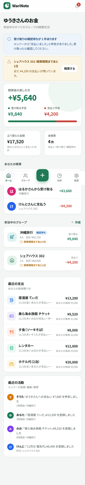
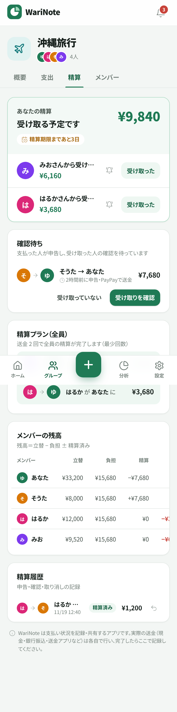
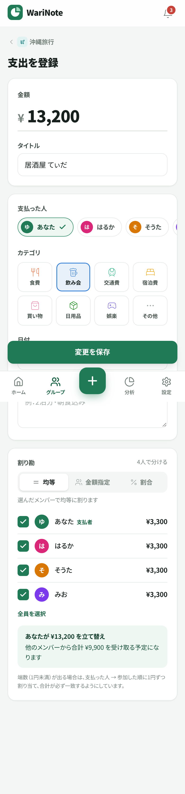
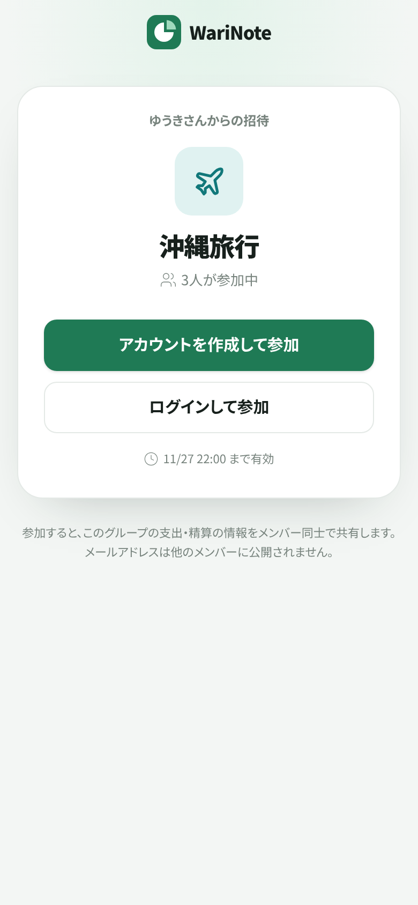

# WariNote（ワリノート）— 割り勘・共有家計管理 Web アプリ

友達・カップル・旅行・ルームシェア・サークルなど、**複数人のお金の立替・割り勘・精算**を一つの帳簿で管理するアプリです。
各メンバーが**自分のアカウント・自分のスマホ**から使い、同じグループのデータを**リアルタイムに共有**します。

| ホーム | 精算 | 支出の登録 | 招待 |
|---|---|---|---|
|  |  |  |  |

## 主な機能

- **アカウント**：メールで新規登録・ログイン・ログアウト・パスワード再設定、プロフィール（表示名・アイコン色）
- **グループ**：自由に作成、招待URLの発行（有効期限つき・無効化可）、LINE で送信、承認制の参加申請、管理者・メンバー権限、退出・削除
- **支出**：タイトル・金額・支払った人・カテゴリ・日付・メモ・割り勘対象者。割り勘は **均等／特定メンバーだけ／金額指定／割合（%）**
- **精算**：誰が誰にいくら払えばよいかを**送金回数が最少**になるよう自動計算。「支払った」申告 → 受け取った人が確認 → 精算済み。履歴・取り消し・二重精算防止
- **支払い忘れ防止**：精算期限、期限前の自動通知（毎朝9時）、受け取る側からのリマインド、未精算の表示
- **通知**：アプリ内通知（支出の追加・編集・削除、精算、参加、リマインド、全員精算完了）をリアルタイムで受信
- **分析**：月別・カテゴリ別・グループ別・メンバー別（立替／負担）のグラフ
- **履歴**：誰がいつ登録・編集・削除したかを変更前後の内容つきで記録
- **スマホ最適化**：下部タブ・ボトムシート・PWA（ホーム画面に追加）

## 技術構成

| 領域 | 採用技術 |
|---|---|
| フロントエンド | Next.js 15（App Router, Server Components, Server Actions）, TypeScript |
| UI | Tailwind CSS v4, shadcn/ui の規約に沿った自前コンポーネント, Lucide アイコン, Recharts |
| バックエンド / DB | Supabase（PostgreSQL, Auth, Realtime, pg_cron） |
| ホスティング | Cloudflare Workers（OpenNext アダプタ） |

設計の詳細は [`docs/DESIGN.md`](docs/DESIGN.md)（画面構成・テーブル設計・端数処理・精算アルゴリズム・セキュリティ）を参照してください。

---

## 公開手順（約15分・すべて無料枠で可）

スマホのブラウザだけでも進められます。

### 1. Supabase（データベース・認証）

1. <https://supabase.com> にログインし **New project** を作成（Region は **Northeast Asia (Tokyo)** がおすすめ）。
2. 左メニュー **SQL Editor** → 新しいクエリに [`supabase/setup.sql`](supabase/setup.sql) の**全文**を貼り付けて **Run**。
   （テーブル・RLS・関数・リアルタイム配信・期限通知ジョブがまとめて作成されます。1回だけ実行してください）
3. **Project Settings → API**（または **Connect**）で次の2つを控えます。
   - Project URL（`https://xxxx.supabase.co`）
   - `anon` / `publishable` キー（公開前提のキー。**service_role キーは使いません**）
4. **Authentication → Sign In / Providers → Email** の設定：
   - 仲間内ですぐ使い始めたい場合は **Confirm email をオフ** にすると、確認メールなしで登録できます。
     （Supabase 標準のメール送信は1時間あたりの送信数が少ないため、数人が同時に登録すると届かないことがあります）
   - 確認メールを使う場合は、**Authentication → Emails → SMTP Settings** で独自の SMTP（Resend 等）を設定するのがおすすめです。

### 2. コードを GitHub に置く

GitHub に新しいリポジトリを作り、この一式をアップロードします。
（claude.ai の設定で GitHub を連携していただければ、Claude からリポジトリに push できます）

### 3. Cloudflare Workers（アプリの公開）

1. Cloudflare ダッシュボード → **Workers & Pages** → **Create** → **Import a repository** → 手順2のリポジトリを選択。
2. 設定：
   | 項目 | 値 |
   |---|---|
   | Project name | `warinote`（`wrangler.jsonc` の `name` と一致させる） |
   | Build command | `npx opennextjs-cloudflare build` |
   | Deploy command | `npx opennextjs-cloudflare deploy` |
3. **Deploy**。数分で `https://warinote.<あなたのサブドメイン>.workers.dev` が発行されます。
4. Worker の **Settings → Variables and Secrets** に次を追加（Type は Text で可）：
   | 名前 | 値 |
   |---|---|
   | `SUPABASE_URL` | 手順1-3 の Project URL |
   | `SUPABASE_ANON_KEY` | 手順1-3 の anon / publishable キー |

   ※ `wrangler.jsonc` で `keep_vars: true` にしているため、次回以降のデプロイでも消えません。
   ※ 設定前にアクセスすると「初期設定が完了していません」と表示されます（正常です）。

### 4. Supabase に公開URLを登録

**Authentication → URL Configuration**
- **Site URL**：`https://warinote.<サブドメイン>.workers.dev`
- **Redirect URLs**：`https://warinote.<サブドメイン>.workers.dev/**`

**（確認メールを使う場合・推奨）Authentication → Emails → Templates**
登録時と別のブラウザ（メールアプリ内ブラウザ等）でリンクを開いても確認できるよう、リンク部分を次に変更します。
- Confirm signup：
  `{{ .SiteURL }}/auth/confirm?token_hash={{ .TokenHash }}&type=email&redirect_to={{ .RedirectTo }}`
- Reset Password：
  `{{ .SiteURL }}/auth/confirm?token_hash={{ .TokenHash }}&type=recovery&next=/reset-password`

### 5. 動作確認（例：4人の沖縄旅行）

1. Aさんが登録 → 「沖縄旅行」グループを作成 → 招待リンクを LINE で送る
2. B・C・Dさんがリンクを開き、それぞれ自分のアカウントで登録して参加
3. A：ホテル代 20,000円、B：レンタカー 12,000円、C：食事代 8,000円 を登録
4. 全員の画面に即時反映され、精算タブに **D→A 10,000円 / C→B 2,000円**（送金2回）が表示される
5. D が「支払った」→ A が「受け取りを確認」→ 全員の画面で精算済みに

---

## ローカル開発

```bash
npm install
cp .env.example .env.local        # SUPABASE_URL / SUPABASE_ANON_KEY を設定
npm run dev                       # http://localhost:3000
npm run preview                   # Cloudflare Workers ランタイムでの確認（.dev.vars を使用）
```

Supabase CLI を使う場合：`supabase init` → `supabase start` → `supabase db reset`（マイグレーション＋サンプルデータ）。

## テスト

| コマンド | 内容 |
|---|---|
| `npm test` | 割り勘・端数処理・精算最適化のユニットテスト（ランダム13,000ケース。送金回数が理論上の最小になることを総当たりで照合） |
| `npm run test:db` | 実際の PostgreSQL にマイグレーションを適用し、**複数ユーザー・セキュリティテスト 118 項目**を実行（要 PostgreSQL） |
| `npx tsx tests/crosscheck-sql.ts` | 画面側（TypeScript）と DB 側（SQL）の割り勘計算が一致するかをランダム入力で照合 |
| `npm run typecheck` | 型チェック |

DB テストの主な内容：4人の沖縄旅行シナリオ／部外者は他グループの支出・メンバー・残高・プロフィール・通知を一切見られない／未ログインは何も読めない／テーブルへの直接書き込みは権限エラー／他人の通知・プロフィールは改ざん不可／二重精算・過剰精算の拒否／連打しても精算は1件／精算済み支出の編集には確認が必要／同時編集の衝突検知／承認制参加／招待の失効。

## セキュリティ

- **全テーブルで RLS**。参照は「自分が所属するグループのデータ」だけ。クライアント側の表示制御には依存しません。
- **書き込みは検証付きの DB 関数（RPC）経由のみ**。テーブルへの直接 INSERT/UPDATE/DELETE 権限は付与していません。
- 金額・負担額は **DB 側で再計算・検証**（画面の計算結果をそのまま信用しない）。
- メールアドレスは他のメンバーに公開しません（`profiles` に保持しない）。
- アプリは利用者本人の JWT で Supabase にアクセスし、`service_role` キーは一切使用しません。
- 招待トークンは推測不能な長いランダム値。有効期限・無効化・使用回数を管理。

## テスト用データと本番データの分離

- `supabase/seed.sql` は**ローカル開発（`supabase db reset`）専用**で、本番用の `setup.sql` には含まれません。
- サンプルユーザーは実在しない `@example.com` ドメインのみ。
- 本番と開発は **Supabase プロジェクトを分ける**ことを推奨します（環境変数で切り替え）。

## ディレクトリ構成

```
src/
  app/            画面（(auth) 認証 / (app) ログイン後 / invite 招待 / auth コールバック）
  components/     ui（共通部品） / app / group / expense / settle / charts / views
  lib/            split.ts（割り勘） settle.ts（精算最適化） money.ts queries.ts actions/ supabase/
supabase/
  migrations/     スキーマ・RLS・RPC・Realtime（setup.sql はこれらを結合したもの）
  tests/          複数ユーザー・セキュリティテスト（SQL）とローカル実行スクリプト
  seed.sql        ローカル開発用サンプルデータ
tests/            ユニットテスト・TS/SQL 照合
docs/             設計書・スクリーンショット
```

## 補足・既知の制約

- 本リポジトリは作成環境の都合で依存パッケージを取得できなかったため、`next build` は Cloudflare 側のビルドで初めて実行されます。
  そのため `next.config.ts` ではビルド時の型チェックで止めない設定（`ignoreBuildErrors`）にしています。
  ロジック部分は strict な型チェック済みで、全ソースのコンパイル・import 整合も検証済みです。`npm install` 後に `npm run typecheck` を一度実行してください。
- 通知はアプリ内のみ。すべての通知は `notifications` テーブルを通るため、Supabase の Database Webhook / Edge Function を追加すればメール・Web Push に拡張できます。
- 実際の送金・決済は行いません（支払い状況の記録・共有アプリです）。
